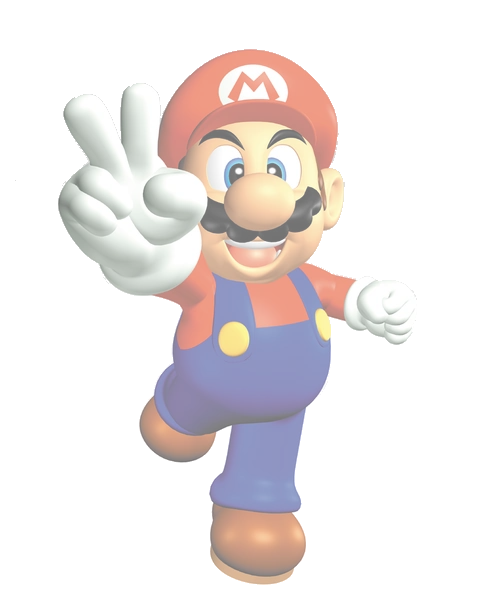

# Super Mario 64 — Discord Theme (Vencord / BetterDiscord)

Rot-schwarzes Theme im Super-Mario-64-Look mit halbtransparentem Mario-Bild im Hintergrund
und gelben Akzenten (Message-Bar, Sterne, Eingabezeile als „? Block“).



## Installation

**Vencord**
1. Vencord → Einstellungen → Themes → **Themes-Ordner öffnen**
   (Windows: `%appdata%\Vencord\themes`)
2. `SuperMario64.theme.css` **und** `mario64-bg.png` in diesen Ordner kopieren
   (beide Dateien müssen zusammen bleiben – das Bild wird relativ geladen)
3. Themes neu laden (`Strg+R`) und den Schalter **Super Mario 64 — Rot & Schwarz** aktivieren

**BetterDiscord**
Gleiches Vorgehen: beide Dateien in den Themes-Ordner, dann in den Einstellungen aktivieren.

## Anpassen

Die wichtigsten Werte stehen ganz oben in der CSS-Datei:

```css
--sm64-bg-size: 68vmin;   /* Größe des Mario-Bildes */
--sm64-bg-opacity: 0.55;  /* Deckkraft des Bildes   */
--sm64-red: #e52521;
--sm64-star: #fbd000;
```

## Dateien

| Datei | Zweck |
|---|---|
| `SuperMario64.theme.css` | das Theme |
| `mario64-bg.png` | halbtransparentes Hintergrundbild |
| `preview.html` | HTML-Vorschau (im Browser öffnen) |
| `preview.png` | Screenshot für dieses README |
| `install.ps1` | kopiert Theme + Bild in den Vencord-Themes-Ordner (Windows) |

## Lizenz

Theme-CSS frei verwendbar. Super Mario 64 und alle Figuren sind Eigentum von Nintendo —
dies ist ein inoffizielles Fan-Projekt ohne Verbindung zu Nintendo.
